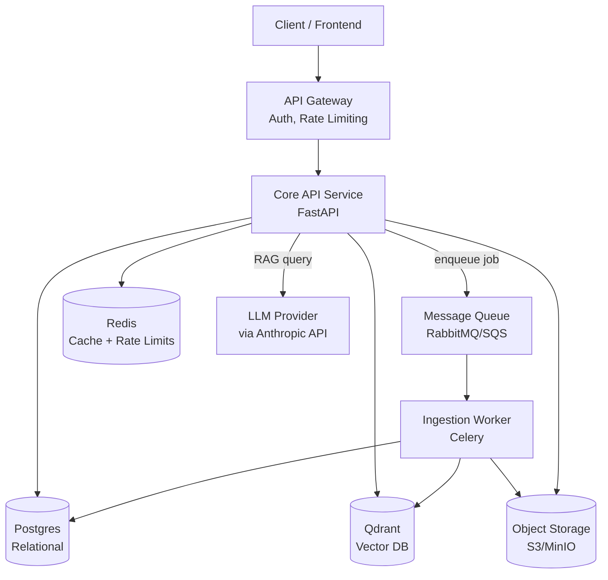

Let's design this properly — a multi-tenant document intelligence platform (call it **DocuMind** for reference) with real architectural decisions, not just a tool list.

## System Overview



## 1. Service Boundaries

Even if you deploy this as a "modular monolith" first (recommended — see phasing note at the end), design it as logically separate services:

| Service                   | Responsibility                                                              |
| ------------------------- | --------------------------------------------------------------------------- |
| **Auth Service**          | Tenant/user management, JWT issuance, API keys, RBAC                        |
| **Ingestion Service**     | File upload handling, virus scan, text extraction, chunking                 |
| **Embedding Worker**      | Generates embeddings, writes to vector DB, handles re-indexing              |
| **Query/RAG Service**     | Hybrid search, re-ranking, LLM orchestration, answer synthesis              |
| **Billing/Usage Service** | Metering (documents processed, tokens used, queries run), quota enforcement |
| **Notification Service**  | Webhooks/emails when ingestion completes or fails                           |

## 2. Relational Schema (Postgres)

This is the part people usually rush — don't. A thoughtful multi-tenant schema is a real signal.

```sql
-- Tenants and isolation
CREATE TABLE tenants (
    id UUID PRIMARY KEY DEFAULT gen_random_uuid(),
    name TEXT NOT NULL,
    plan TEXT NOT NULL DEFAULT 'free', -- free, pro, enterprise
    created_at TIMESTAMPTZ DEFAULT now(),
    is_active BOOLEAN DEFAULT true
);

CREATE TABLE users (
    id UUID PRIMARY KEY DEFAULT gen_random_uuid(),
    tenant_id UUID NOT NULL REFERENCES tenants(id),
    email TEXT NOT NULL,
    hashed_password TEXT NOT NULL,
    role TEXT NOT NULL DEFAULT 'member', -- owner, admin, member
    created_at TIMESTAMPTZ DEFAULT now(),
    UNIQUE(tenant_id, email)
);

CREATE TABLE api_keys (
    id UUID PRIMARY KEY DEFAULT gen_random_uuid(),
    tenant_id UUID NOT NULL REFERENCES tenants(id),
    key_hash TEXT NOT NULL,      -- never store raw keys
    scopes TEXT[] NOT NULL,      -- ['documents:read', 'documents:write']
    created_at TIMESTAMPTZ DEFAULT now(),
    last_used_at TIMESTAMPTZ,
    revoked_at TIMESTAMPTZ
);

-- Documents and processing state
CREATE TABLE documents (
    id UUID PRIMARY KEY DEFAULT gen_random_uuid(),
    tenant_id UUID NOT NULL REFERENCES tenants(id),
    uploaded_by UUID REFERENCES users(id),
    filename TEXT NOT NULL,
    storage_path TEXT NOT NULL,   -- S3 key
    mime_type TEXT NOT NULL,
    status TEXT NOT NULL DEFAULT 'pending',
        -- pending, extracting, chunking, embedding, ready, failed
    error_message TEXT,
    file_hash TEXT,               -- dedupe identical uploads
    created_at TIMESTAMPTZ DEFAULT now(),
    processed_at TIMESTAMPTZ
);
CREATE INDEX idx_documents_tenant_status ON documents(tenant_id, status);

-- Chunks: metadata lives here, vectors live in Qdrant, linked by chunk id
CREATE TABLE chunks (
    id UUID PRIMARY KEY DEFAULT gen_random_uuid(),
    document_id UUID NOT NULL REFERENCES documents(id) ON DELETE CASCADE,
    tenant_id UUID NOT NULL REFERENCES tenants(id),  -- denormalized for fast filtering
    chunk_index INT NOT NULL,
    content TEXT NOT NULL,
    token_count INT,
    embedding_status TEXT DEFAULT 'pending', -- pending, embedded, failed
    created_at TIMESTAMPTZ DEFAULT now()
);
CREATE INDEX idx_chunks_document ON chunks(document_id);

-- Usage metering for billing
CREATE TABLE usage_events (
    id UUID PRIMARY KEY DEFAULT gen_random_uuid(),
    tenant_id UUID NOT NULL REFERENCES tenants(id),
    event_type TEXT NOT NULL,   -- 'document_processed', 'query_run', 'tokens_consumed'
    quantity NUMERIC NOT NULL,
    created_at TIMESTAMPTZ DEFAULT now()
);
CREATE INDEX idx_usage_tenant_time ON usage_events(tenant_id, created_at);

-- Audit log — good security signal
CREATE TABLE audit_logs (
    id UUID PRIMARY KEY DEFAULT gen_random_uuid(),
    tenant_id UUID NOT NULL REFERENCES tenants(id),
    actor_id UUID,
    action TEXT NOT NULL,
    resource_type TEXT,
    resource_id UUID,
    metadata JSONB,
    created_at TIMESTAMPTZ DEFAULT now()
);
```

**Key design decision to be ready to explain in an interview:** tenant isolation via `tenant_id` filtering on every query, enforced at the application layer _and_ with Postgres Row-Level Security as a defense-in-depth measure:

```sql
ALTER TABLE documents ENABLE ROW LEVEL SECURITY;
CREATE POLICY tenant_isolation ON documents
    USING (tenant_id = current_setting('app.current_tenant')::UUID);
```

You set `app.current_tenant` per request/connection. This is a detail that separates "I used Postgres" from "I understand multi-tenant security."

## 3. Vector DB Design (Qdrant)

- One collection, **not** one collection per tenant (doesn't scale past a few hundred tenants) — instead use **payload-based filtering**:

```json
{
  "vector": [0.021, -0.113, ...],
  "payload": {
    "tenant_id": "uuid",
    "document_id": "uuid",
    "chunk_id": "uuid",
    "chunk_index": 3
  }
}
```

Every query includes a mandatory filter on `tenant_id` — this is enforced in code, tested explicitly (write a test that tries to leak across tenants and asserts zero results), and is a great thing to point to when someone asks "how did you handle multi-tenancy."

- Use **hybrid search**: Qdrant's sparse+dense vectors, or run BM25 (via Postgres full-text search or Elasticsearch) in parallel and merge with reciprocal rank fusion. This shows you know pure vector search isn't always best.

## 4. API Design

REST for CRUD, with async patterns for anything slow:

```
POST   /v1/documents                    → upload, returns 202 + document_id, kicks off pipeline
GET    /v1/documents/{id}                → status + metadata
GET    /v1/documents/{id}/chunks         → paginated chunks
DELETE /v1/documents/{id}                → soft delete, cascades to vector DB cleanup

POST   /v1/query                         → { "question": "...", "document_ids": [...] }
                                            returns synthesized answer + cited chunks

GET    /v1/usage                         → current billing period usage
POST   /v1/webhooks                      → register a webhook for ingestion events
```

**Async upload flow** (important detail — don't process synchronously):

1. `POST /v1/documents` → validate, store file in S3, insert `documents` row with `status=pending`, publish message to queue, return `202 Accepted` immediately
2. Worker picks up job → extract text → chunk → update `status=embedding`
3. Worker generates embeddings, batches upsert into Qdrant → `status=ready`
4. Notification service fires webhook or the client polls `GET /v1/documents/{id}`

Also implement **idempotency keys** on the upload endpoint (`Idempotency-Key` header) so retried requests don't double-process — a small detail that signals production experience.

## 5. RAG Query Pipeline (the AI integration piece)

Don't just do naive "embed query → top-k → stuff into prompt." Build something with actual engineering in it:

1. Query comes in → check Redis cache (hash of tenant+question+doc_ids) for a recent identical answer
2. Embed the query
3. Run hybrid retrieval: vector search (top 20) + BM25 keyword search (top 20), filtered by `tenant_id`
4. Merge/deduplicate, re-rank with a cross-encoder (e.g., a small local model or Cohere rerank) down to top 5
5. Construct prompt with citations required, call the LLM
6. Parse response, map citations back to `chunk_id`s so the frontend can show "sourced from Document X, page 3"
7. Log the query + token usage to `usage_events`

This pipeline alone gives you a lot to talk about: caching strategy, retrieval quality tradeoffs, why re-ranking matters, prompt engineering for grounded answers, cost control.

## 6. DevOps / Infrastructure

- **Local dev:** `docker-compose.yml` with Postgres, Qdrant, Redis, RabbitMQ, MinIO (S3-compatible), API, worker
- **CI (GitHub Actions):**
  - lint + type check
  - unit tests
  - integration tests that spin up real Postgres + Qdrant containers (via `services:` in the workflow) — this is more impressive than mocked tests
  - build and push Docker images on merge to main
- **CD:** deploy to a Kubernetes cluster (even a small managed one — EKS/GKE, or k3s on a VPS to keep costs down) with:
  - separate Deployments for API and worker (worker scales independently based on queue depth — use KEDA if you want to show autoscaling-on-queue-length)
  - Horizontal Pod Autoscaler on the API based on CPU/latency
  - Secrets via Kubernetes Secrets or Vault, never in env files committed to git
- **IaC:** Terraform for the cloud resources (S3 bucket, RDS instance, networking) — even a modest Terraform setup shows you don't click around a console
- **Observability:** Prometheus + Grafana for metrics (queue depth, ingestion latency, query latency, LLM cost per tenant), structured logging (JSON logs → Loki or ELK)

## 7. Suggested Build Order (phasing, so it's actually finishable)

1. **Phase 1:** Postgres schema + auth + single-tenant document upload/extraction, no AI yet — prove the pipeline works
2. **Phase 2:** Add embeddings + vector search + basic RAG query endpoint
3. **Phase 3:** Multi-tenancy hardening (RLS, isolation tests, quotas)
4. **Phase 4:** Async pipeline with queue + worker, webhooks
5. **Phase 5:** Observability + CI/CD + Kubernetes deployment
6. **Phase 6 (polish):** hybrid search + re-ranking, usage-based billing, admin dashboard

This order means you have a demoable thing after phase 2, and each later phase is a clean, describable "here's the problem I solved" story for interviews.

---

Want me to go deeper on any one piece — e.g. write the actual FastAPI project structure and starter code, the Kubernetes manifests, or the chunking/embedding worker logic?
